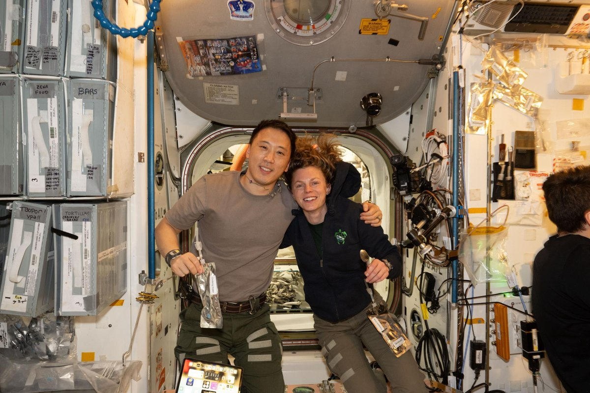
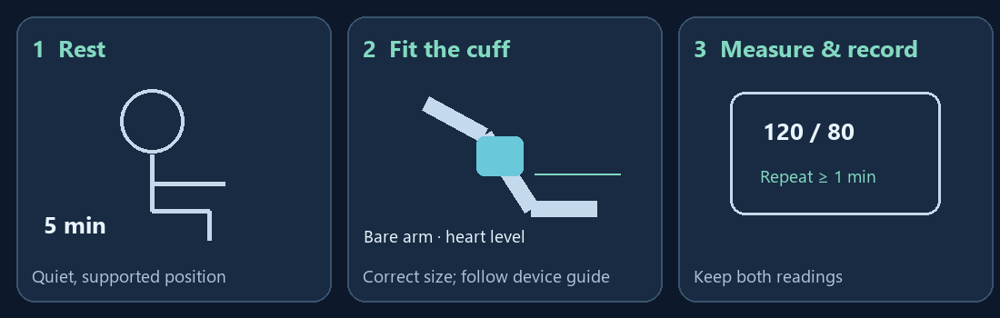

# Periodic blood pressure assessment

NASA requires periodic in-flight health evaluations and reporting to the Crew Surgeon. This workflow combines that framework with the American Heart Association's measurement technique. The mission's device instructions determine operation in microgravity.

## Equipment and preparation

Use a validated upper-arm monitor, correctly sized cuff, record sheet and a timer. Confirm the crew member, planned examination and medical communication channel.

1. Avoid exercise and caffeine for 30 minutes before measurement. Empty the bladder.
2. Rest quietly for five minutes. Do not talk during rest or measurement.
3. On Earth, support the back and feet; keep legs uncrossed. In flight, use the prescribed restraints and support the arm without muscle effort.

## Measure

4. Place the cuff on bare skin, with its lower edge about 2–3 cm above the elbow crease. Align the artery marker as specified by the manufacturer.
5. Support the middle of the cuff at heart level. Remain still and start the monitor.
6. Record systolic pressure, diastolic pressure and pulse. If an error appears, check the fit and movement before repeating.
7. Obtain a second reading after at least one minute. Keep both readings; do not select only the lower result.

## Record and close

Enter time, arm, posture or restraint, cuff size, both readings, recent activity and symptoms. Send the record through the private medical channel for review; the flight surgeon decides further testing. New chest pain, severe breathlessness, fainting or a sudden neurological change requires the emergency pathway rather than completion of a routine check.

### Record template

| Field | Entry |
|---|---|
| Crew member / examiner / time | |
| Device / cuff / arm / posture | |
| Reading 1 / pulse | |
| Reading 2 / pulse | |
| Symptoms / recent activity | |
| Review and follow-up | |

## Sources

- [NASA OCHMO-STD-100.1A Rev. A, §6.1.2, pp. 38–39](https://www.nasa.gov/wp-content/uploads/2023/04/ochmo-std-100.1a.pdf)
- [AHA scientific statement: Measurement of Blood Pressure in Humans, Table 5](https://pmc.ncbi.nlm.nih.gov/articles/PMC11409525/)
- [NASA photograph and cardiovascular research context](https://www.nasa.gov/blogs/spacestation/2025/08/21/ultrasound-scans-on-station-monitor-and-protect-crew-cardiovascular-health/)

Step illustration: HALO. Compiled workflow; not an issued NASA flight checklist.
