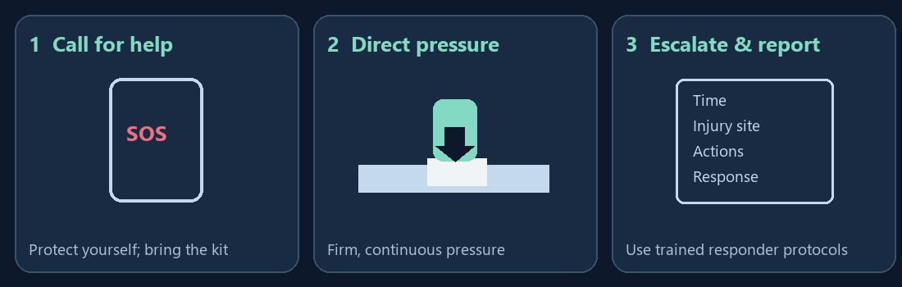

# ICE — external bleeding

This procedure draws on NASA Kennedy Space Center's Stop the Bleed guidance. Its ground first-aid principles are organized here for a crew interface; vehicle-specific emergency instructions take precedence.

## Recognize and prepare

Treat rapid blood loss, pooling blood or bleeding that will not stop as an emergency. Make the area safe, call for help immediately and alert the Crew Medical Officer through the mission emergency channel. On Earth, activate local emergency medical services.

Bring gloves, gauze or a clean dressing and the bleeding-control kit. Protect yourself from blood contact. Expose the injury enough to locate the bleeding source; keep equipment secured in microgravity.

## Act

1. Press firmly and continuously directly over the wound using gauze, a dressing or a clean cloth. Maintain pressure while help is arranged.
2. For severe, life-threatening bleeding from an arm or leg, use a manufactured tourniquet if available and you are trained. Follow its instructions; position it 2–3 inches above the wound and not over a joint, then tighten until bleeding stops. Record application time. Do not loosen it yourself.
3. Deep wounds may require packing by a trained responder; follow the applicable bleeding-control protocol. Continue direct pressure and hand over to the medical lead.

## Reassess and hand over

Stay with the injured person. Watch responsiveness and breathing; report deterioration immediately and follow the mission emergency algorithm. Keep observing the dressing for renewed bleeding.

### Emergency record

| Field | Entry |
|---|---|
| Location / crew member / time | |
| Injury site and observed blood loss | |
| Pressure started / response | |
| Tourniquet site and time, if used | |
| Responsiveness / breathing / vital signs | |
| Medical contact / next action | |

## Sources

- [NASA Kennedy Space Center — Stop the Bleed](https://www.nasa.gov/kennedy/stop-the-bleed/)
- [AHA First Aid guidance — bleeding control](https://cpr.heart.org/en/resuscitation-science/first-aid-guidelines/first-aid)
- [NASA — Medical Kits for ISS, photograph](https://www.nasa.gov/image-article/medical-kits-iss/)

Step illustration: HALO. Compiled first-aid workflow; not an issued NASA flight checklist.
