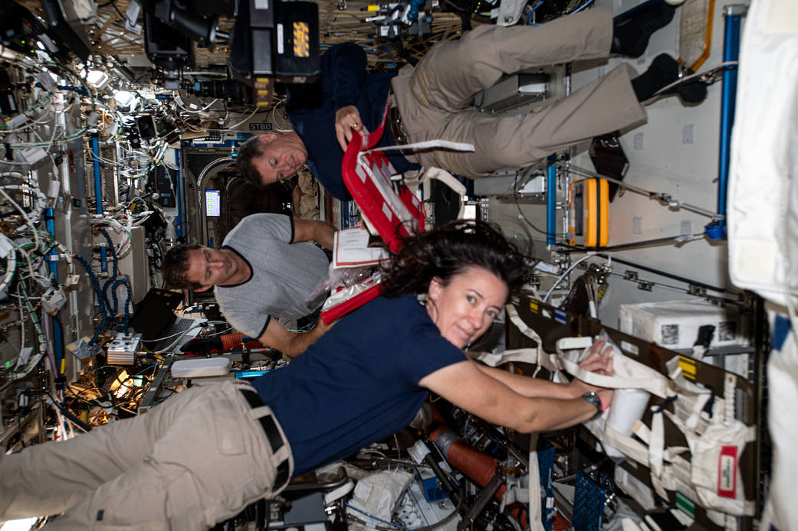

# Cardiac Arrest & CPR Protocol

> **CRITICAL EMERGENCY:** Activate the emergency response immediately. Use the trained microgravity stabilization technique; do not wait for telemetry or a particular restraint board before activating help and beginning the trained response.

## 1. Recognize and activate the response
1. **Verify Unresponsiveness:** Tap shoulders and shout. 
2. **Check Breathing:** Unresponsiveness with absent or abnormal breathing (including gasping) requires the cardiac-arrest response. A trained healthcare responder checks for a definite pulse for no more than 10 seconds. Do not wait for `0 BPM` or falling `SpO2`; app telemetry cannot confirm or exclude arrest.
3. **Declare Emergency:** Broadcast **"CODE MEDICAL - CARDIAC ARREST"** to Mission Control and all module crew.

---

## 2. Stabilization (Crucial for Microgravity)
1. **Stabilize the Patient:** Use the approved restraint and trained microgravity method as quickly as possible. If a CMR board is used, follow its instructions and leave the sternum unobstructed. Avoid unnecessary interruptions for transfer.
2. **Stabilize the Rescuer:** Use the restraint, tether or bracing method taught for the specific vehicle and equipment. Do not improvise attachment points.

---

## 3. Chest Compressions & Airway (CPR)
1. **Hand Placement:** Place the heel of one hand on the lower half of the sternum.
2. **Compressions:** 
   * Push hard and fast: **100 - 120 compressions per minute**.
   * Depth: 5–6 cm in an average adult; avoid excessive depth.
   * Allow full chest recoil (do not pull the patient up with you).
3. **Ventilation (30:2 Ratio):** After 30 compressions, a trained responder provides 2 breaths with the available mask or bag-mask, enough for visible chest rise. Use medical oxygen only with the approved equipment and procedure.

---

## 4. AED Deployment (Automated External Defibrillator)
1. **Retrieve AED:** A second crew member retrieves the AED from the configured medical equipment location.
2. **Apply Pads:** Bare the patient's chest. Wipe away any sweat (liquids pool on the skin in zero-g). Apply pads:
   * **Right pad:** Below the right collarbone.
   * **Left pad:** Lower left side of the ribs.
3. **Analyze & Shock:** 
   * Ensure NO CREW MEMBER is touching the patient or the metal CMR board.
   * Follow AED voice prompts. If shock is advised, press the flashing button.
4. **Resume CPR:** Immediately resume chest compressions after the shock is delivered. 

## 5. Medical Payload & Drugs
* IV/IO access and medication are advanced care. Only a qualified responder follows the approved resuscitation protocol and Flight Surgeon direction; this card does not prescribe a drug regimen.

## Sources and context

- [NASA: Expedition 65 astronauts train for a medical emergency](https://www.nasa.gov/image-article/expedition-65-astronauts-train-medical-emergency/)
- [AHA: Adult Basic Life Support](https://cpr.heart.org/en/resuscitation-science/cpr-and-ecc-guidelines/adult-basic-life-support/)

User-supplied workflow, with recognition and stabilization wording corrected for training use. Not an issued NASA flight checklist.
